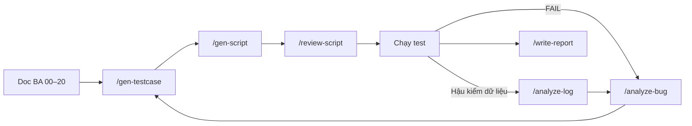

# 🧪 kit-test-parsca — Agent Kit Kiểm Thử Role Vendor PARSCA

> Bộ cấu hình agent (rules · skills · workflows) cho Antigravity, dựng lại từ **antigravity-testing-kit-main** và chuyên biệt hoá cho **role Vendor** của marketplace **PARSCA**.
> Nguồn nghiệp vụ: [`docs/parsca-vendor-test-docs/`](../docs/parsca-vendor-test-docs/README.md) (22 file, bản sao từ `antigravity-testing-kit-main/parsca-vendor-test-docs/`).

---

## ⚠️ Đọc Trước

1. FE gọi API có `/v1` + `{data, meta}`, BE zip thì không → **xác nhận với Dev trước khi chạy** (Doc 01).
2. Màn **[GIẢ LẬP]** (Dashboard, Orders, Reviews, Payouts, Settings, một phần Profile): không ghi bug "không lưu / không gọi API".
3. Hành vi **THEO CODE HIỆN TẠI** → ghi câu hỏi PO (Q-Vx), trạng thái **OBSERVED**, không PASS.
4. Không ghi / in credentials; truy vấn DB chỉ SELECT; không dùng git làm đổi trạng thái code.

---

## 📂 Cấu Trúc

```
kit-test-parsca/
├── GEMINI.md                            # Rule tổng cho agent (chuyển thể từ GEMINI.md của kit gốc)
├── docs/parsca-vendor-test-docs/        # Tài liệu BA (00–20) — nguồn sự thật
├── plans/                               # Prompt templates theo quy trình (mirror plans/ của kit gốc)
│   ├── manual/                          # AI-RBT 6 bước → testcase PARSCA_<MOD>_TC_NNN
│   ├── automation/                      # Bước 0 kiến trúc + 6 bước Playwright TS + prompt one-click
│   └── cross-module/                    # Ma trận kết hợp (LC/RL/IM/IMG) + scripts/pairwise_product_lifecycle.py
├── practices/                           # Tài liệu thực hành (mirror practices/ của kit gốc)
│   ├── requirements/                    # parsca-vendor/ 01–06 + jira/ (PVEN-* mẫu)
│   ├── context/ · analysis/ · test_plan/ # Bối cảnh, phân tích + Q&A, test plan
│   ├── testcases/                       # vendor/ 262 TC + api/ 78 TC (+ .xlsx)
│   ├── scripts/generate_fixtures.py     # Sinh fixture (stdlib)
│   └── test-data/                       # csv/ (commit) + generated/ (gitignore)
└── .agent/
    ├── README.md                        # File này
    ├── rules/
    │   ├── core.md                      # Vai trò, nhãn doc, business rules, format chuẩn, dos/don'ts, an toàn
    │   ├── selectors.md                 # Priority selector Playwright, anti-patterns, quy trình verify
    │   └── test-data.md                 # Chuẩn test data PARSCA: tài khoản, email, password, SKU, amount, discount, file
    ├── skills/
    │   ├── generate-testcase/           # SKILL.md + resources/module_catalog.md
    │   ├── generate-playwright-script/  # SKILL.md
    │   ├── analyze-bug/                 # SKILL.md
    │   ├── write-test-report/           # SKILL.md
    │   └── analyze-metabase-log/        # SKILL.md + resources/anomaly_queries.md
    └── workflows/
        ├── gen-testcase.md
        ├── gen-script.md
        ├── analyze-bug.md
        ├── write-report.md
        ├── analyze-log.md
        └── review-script.md
```

> Để Antigravity nhận workflow/skill: mở **`kit-test-parsca/`** làm workspace root (thư mục `.agent/` phải nằm ở gốc workspace).

### 📚 Plans (prompt templates)

| Thư mục | Dùng khi | Bắt đầu |
|---------|----------|---------|
| [`plans/manual/`](../plans/manual/README.md) | Sinh manual TC theo AI-RBT 6 bước (copy-paste hoặc `/gen-testcase`) | [`QUICK_START.md`](../plans/manual/QUICK_START.md) |
| [`plans/automation/`](../plans/automation/README.md) | Dựng `playwright-parsca/`, sinh spec từ TC (`/gen-script`, `/review-script`) | [`QUICK_START.md`](../plans/automation/QUICK_START.md), [`prompt_automation.txt`](../plans/automation/prompt_automation.txt) |
| [`plans/cross-module/`](../plans/cross-module/README.md) | Luồng nhiều module nối tiếp (vòng đời sản phẩm, đổi role, import) — ma trận pairwise | [`QUICK_START.md`](../plans/cross-module/QUICK_START.md) |

### 🗂️ Practices (tài liệu thực hành)

| Thư mục | Nội dung | Bắt đầu |
|---------|----------|---------|
| [`practices/`](../practices/README.md) | Requirements, Jira mẫu, context, phân tích, test plan, 262 TC manual + 78 TC API, fixture | [`README.md`](../practices/README.md) (Smoke 13 TC, thứ tự regression) |

---

## ⚡ Slash Commands

| Lệnh | Mục đích | Skill | Input tối thiểu | Output |
|------|----------|-------|-----------------|--------|
| `/gen-testcase` | Sinh testcase manual 12 cột từ user story / AC / doc BA | `generate-testcase` | Tên doc (vd `12-import-csv.md`) hoặc AC | `practices/testcases/vendor/TC_PARSCA_VENDOR_<MOD>.md` (+ Excel) |
| `/gen-script` | Sinh Playwright TypeScript spec từ testcase | `generate-playwright-script` | File TC + TC ID / tag; `{FE_URL}`, `{API_URL}` | Page Objects, fixtures, specs PASS 2 lần |
| `/analyze-bug` | Phân tích bug / log lỗi: Fact → Root cause → Recommendation | `analyze-bug` | Mô tả lỗi + bằng chứng | Phân loại + bug report chuẩn |
| `/write-report` | Viết test report sprint / release + Go/No-Go | `write-test-report` | Kết quả manual / JUnit / Playwright report | `reports/TEST_REPORT_...md` |
| `/analyze-log` | Phân tích Metabase / SQL phát hiện bất thường dữ liệu | `analyze-metabase-log` | Kết quả query hoặc mục tiêu (ANM-xx) | Báo cáo bất thường + hành động |
| `/review-script` | Review script: selector, wait, TC mapping, data, bảo mật | `generate-playwright-script` | File spec (+ file TC) | Danh sách finding + diff đề xuất |

### Ví dụ prompt
```
/gen-testcase Mode FULL cho docs/parsca-vendor-test-docs/12-import-csv.md
/gen-script tests cho các TC @Smoke trong practices/testcases/vendor/TC_PARSCA_VENDOR_02_DATA_SCOPE.md
/analyze-bug Vendor V1 mở /vendor/products/<id V2> thấy dữ liệu sản phẩm (đính kèm HAR)
/write-report release v1.0 từ test-results/junit.xml và bug list đính kèm
/analyze-log ANM-03 — kết quả query SKU trùng đính kèm
/review-script tests/vendor/csv.import.spec.ts so với TC_PARSCA_VENDOR_05_IMPORT_CSV.md
```

---

## 🔁 Luồng Làm Việc Khuyến Nghị



---

## 🗺️ Module PARSCA Vendor (tóm tắt)

| Risk | Module |
|------|--------|
| 🔴 High | ROLE (02), LOGIN (03), SESS (04), SCOPE (06), PSTAT (10), PFORM (09), CSV (12), WEB (20), API (05) |
| 🟡 Medium | PLIST (07), IMG (11), ORDD (15), PAY (17), PROF (19) |
| 🟢 Low | PDTL (08), DASH (13), ORD (14), REV (16), SET (18) |

Chi tiết: [`skills/generate-testcase/resources/module_catalog.md`](skills/generate-testcase/resources/module_catalog.md).

---

## 🔗 Quan Hệ Với antigravity-testing-kit-main

| Thành phần gốc | Tương ứng trong kit này |
|----------------|-------------------------|
| `rules/automation_rules.md`, `playwright_rules.md` | `rules/core.md` + `skills/generate-playwright-script` |
| `rules/locator_strategy.md` | `rules/selectors.md` |
| `skills/test_data_generator` | `rules/test-data.md` |
| `skills/rbt_manual_testing`, `/generate_manual_testcases_rbt` | `skills/generate-testcase`, `/gen-testcase` |
| `/generate_automation_from_testcases` | `/gen-script` |
| `skills/flaky_test_analyzer`, `locator_healer_agent` | `/analyze-bug` (Test issue) + `/review-script` |
| `scripts/convert_excel`, `scripts/integrations/jira`, `scripts/integrations/google_sheet` | `kit-test-parsca/scripts/` cùng cấu trúc — 12 cột manual / 6 cột API, project `PVEN`, trạng thái `OBSERVED` / `BLOCKED`, catalog M1–M18 (`scripts/common/parsca_catalog.js`) |
| `plans/manual`, `plans/automation`, `plans/cross-module` | `plans/` cùng cấu trúc, điền sẵn bối cảnh PARSCA |
| `practices/requirements`, `practices/testcases`, `practices/requirements/jira/KAN-5` | `practices/` cùng cấu trúc — `requirements/parsca-vendor`, `testcases/vendor` + `api`, `requirements/jira/PVEN-*` (mẫu) |
| (mới) | `/write-report`, `/analyze-log` |
