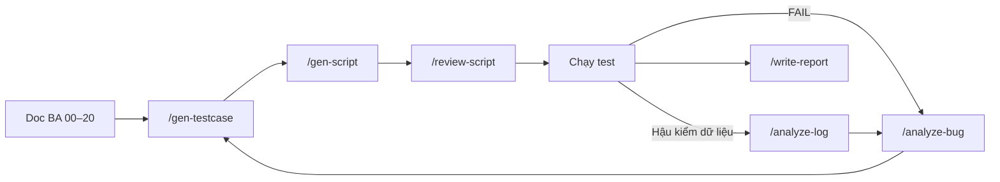

# GEMINI AI - PARSCA VENDOR QA AGENT RULES

> **Scope:** Áp dụng cho mọi tác vụ QA (manual testcase, Playwright script, bug analysis, report, log analysis, review) do Gemini (Antigravity) thực hiện trong **`kit-test-parsca/`** — kiểm thử **role Vendor** của marketplace **PARSCA** (phụ tùng Marine / Auto / Door / Tools).
> **Mục tiêu:** Test case bám đúng tài liệu BA, test scripts ổn định – dễ debug – dễ scale – CI friendly, phân biệt rõ **Bug / Question PO / Observation**.
> **Kế thừa:** Chuyển thể từ [`antigravity-testing-kit-main/GEMINI.md`](../GEMINI.md). Có hiệu lực khi mở **`kit-test-parsca/`** làm workspace root (thư mục `.agent/` phải nằm ở gốc workspace).
> **Thứ tự ưu tiên:** File này ≈ [`.agent/rules/core.md`](.agent/rules/core.md) > skill > workflow. Nếu mâu thuẫn → theo rule và báo cho User.

---

## Git Pull Restriction Rule

* Tuyệt đối KHÔNG dùng lệnh GIT làm thay đổi trạng thái code (như `git pull`, `git checkout`, `git merge`, `git rebase`, `git reset`) để lấy code hoặc thay đổi nhánh.
* Vì có nhiều trường hợp code trên server chưa được cập nhật, việc pull code về sẽ ghi đè và làm sai toàn bộ phần code đang chỉnh sửa ở máy local.
* Luôn giữ nguyên trạng thái code local hiện tại để làm việc.
* Nếu cần file hoặc nội dung mới (doc BA mới, bản zip BE/FE mới, Jira ticket), hãy yêu cầu người dùng cung cấp thay vì tự ý dùng git.
* **Được phép** dùng lệnh read-only: `git status`, `git diff`, `git log` — để kiểm tra trạng thái mà không thay đổi code.

---

## PARSCA Environment Rules (MANDATORY)

### ⚠️ Pre-flight trước MỌI lần chạy (Doc [01](docs/parsca-vendor-test-docs/01-canh-bao-moi-truong.md))

* FE gọi API có tiền tố **`/v1`** và đọc dữ liệu dạng **`{data, meta}`**; BE trong bản zip **không** có `/v1`, **không** bọc dữ liệu → **xác nhận với Dev trước khi chạy**. Prefix lấy từ biến `API_PREFIX`, **không hard-code**.
* Nếu **mọi API đều lỗi** → **DỪNG**, báo BA/Dev (phân loại *Environment*); **KHÔNG** ghi từng màn hình là bug.
* Ngày hệ thống tháng **10/2026** → bộ lọc thời gian tương đối ở Orders / Reviews trả rỗng với dữ liệu mẫu (05–08/2026) — **không phải lỗi**.
* URL chỉ dùng `{FE_URL}`, `{API_URL}` từ biến môi trường.

### 🏷️ Nhãn trong tài liệu BA (BẮT BUỘC hiểu đúng)

| Nhãn trong doc | Xử lý | Tag | Kết quả chạy |
|----------------|-------|-----|--------------|
| **GHI CHÚ CHO TESTER** | Phải có ≥ 1 TC bao phủ | — | PASS / FAIL |
| **THEO CODE HIỆN TẠI** | Hành vi hiện có, có thể sai nghiệp vụ → ghi câu hỏi PO **Q-Vx** | `@CodeHienTai` | **OBSERVED** (không tính PASS) |
| **[SUY LUẬN]** | Suy ra từ code, chưa chạy thật → kết luận chỉ sau khi chạy | `@SuyLuan` | PASS / FAIL |
| **[GIẢ LẬP]** | Dữ liệu viết cứng trong FE, không gọi API → **KHÔNG ghi bug** "không lưu / không gọi API / dấu —" | `@GiaLap` | PASS / Observation |

* Màn giả lập: Dashboard `/vendor` · Orders `/vendor/orders` · Order detail `/vendor/orders/:id` · Reviews `/vendor/reviews` · Payouts `/vendor/payouts` · Settings `/vendor/settings/*` · Profile (trừ avatar).
* Thiếu môi trường / dữ liệu / quyền để chạy → **BLOCKED** (ghi rõ lý do), không phải SKIP hay FAIL.

---

## Browser Rules (MANDATORY)

### 🖥️ Viewport & Mode

* Tất cả **UI debugging** phải chạy với **desktop viewport**: **`1920x1080`**, locale **`en-US`**
* Bắt buộc **mở browser thật** khi debug (headed mode)
* **Headless mode** chỉ được sử dụng **sau khi test đã debug PASS trên UI**
* CI/CD pipeline **được phép chạy headless mặc định** (`retries: 1` trên CI)

### 🔄 Thứ Tự Debug Bắt Buộc (Playwright MCP / Chrome DevTools MCP)

Khi dùng MCP để debug UI, **LUÔN** tuân theo thứ tự:

```
navigate → resize(1920×1080) → wait_for(page_load) → snapshot → interact → screenshot(on_fail)
```

* **KHÔNG** gọi `navigate` lại nếu đã đang ở đúng trang — tránh reload ngoài ý muốn (và tránh mất phiên `access_token` 15 phút)
* **LUÔN** gọi `resize(width=1920, height=1080)` ngay sau `navigate`
* **LUÔN** verify page đã load xong trước khi lấy snapshot hoặc tương tác
* Đăng nhập bằng tài khoản từ biến môi trường (`${VENDOR1_EMAIL}`…) — **không** gõ / in mật khẩu thật vào chat
* Không dùng tài khoản **V1** cho kịch bản đổi role / reset password (dùng `ROLE_TEST_*`) để không làm đăng xuất suite khác
* Login giới hạn **5 lần/phút/IP** (→ 429) — không spam đăng nhập khi debug

### 📸 Screenshot & Snapshot

* Dùng **`snapshot`** để phân tích DOM và xác định locator
* Dùng **`screenshot`** để lưu bằng chứng khi test fail hoặc để báo cáo
* Chụp **screenshot ngay khi assertion fail** để hỗ trợ truy vết lỗi; kèm request/response (status, body) với lỗi API
* **KHÔNG** chụp screenshot tràn lan — chỉ khi cần thiết (fail / milestone quan trọng)
* Snapshot / HAR / log debug lưu ở thư mục scratch hoặc `/tmp/` — **không** để trong kit

---

## Tools

### 🛠️ Ưu Tiên Sử Dụng

* Ưu tiên **Playwright MCP** (hoặc **Chrome DevTools MCP**) cho tất cả tác vụ debug UI
* API: Playwright `request` / `APIRequestContext` — dùng chung `ApiClient` + storageState
* Tham chiếu rule chi tiết: [Quy tắc Selector](.agent/rules/selectors.md), skill [`generate-playwright-script`](.agent/skills/generate-playwright-script/SKILL.md)

### 🔍 Inspect & Debug

* Mở browser thật để debug (headed mode)
* Inspect **DOM / HTML thực tế** trên trình duyệt — **KHÔNG đoán locator** từ text trong doc BA
* Mở tab Network để đối chiếu endpoint / status code với Doc 05–06 trước khi viết assertion
* Execute và debug test trực tiếp trên UI trước khi sinh code
* **KHÔNG** generate code khi chưa inspect DOM

### ⚡ Nguyên Tắc

* Một locator phải được **verify chạy được** trên browser hiện tại trước khi đưa vào code
* Nếu locator lấy từ code cũ → **bắt buộc verify lại** trước khi dùng
* Thứ tự ưu tiên: `getByRole` → `getByLabel` → `getByPlaceholder` → `getByTestId` → `getByText` → `id/name` → CSS ngữ nghĩa → XPath tương đối (ghi lý do)

---

## Cleanup & Delivery

### ✅ Điều kiện bàn giao (Definition of Done)

Test chỉ được coi là **hoàn thành** khi đáp ứng **toàn bộ** các tiêu chí sau:

#### 🧹 Code Cleanup

- [ ] Xoá toàn bộ `console.log()`, debug log tạm thời
- [ ] Xoá locator không còn sử dụng
- [ ] Không để lại commented-out code
- [ ] Không có `waitForTimeout` / sleep hardcoded
- [ ] Không có test data hardcoded (email, SKU, slug, ID phải random/traceable theo [test-data.md](.agent/rules/test-data.md))
- [ ] Không hard-code `{FE_URL}`, `{API_URL}`, prefix `/v1`

#### 🏗️ Cấu trúc & POM

- [ ] Tuân thủ **Page Object Model** theo [kiến trúc `playwright-parsca/`](plans/automation/project_architecture/README.md) — tách `pages/`, `api/`, `fixtures/`, `utils/`, `tests/`
- [ ] Locator được định nghĩa trong Page class, không viết inline trong test
- [ ] Màn `@GiaLap` đặt trong `pages/vendor/simulated/`
- [ ] Tên spec: `tests/<area>/<mod>.<feature>.spec.ts` (vd `tests/vendor/scope.product-access.spec.ts`)
- [ ] Import không còn thừa (unused imports)

#### ✔️ Chất lượng Test

- [ ] Test **PASS ổn định** ít nhất **2 lần liên tiếp** trên UI (headed mode)
- [ ] Tên test chứa **TC ID** (`PARSCA_<MOD>_TC_NNN` / `API_<GROUP>_TC_NNN`) và tag (`@Smoke`, `@CodeHienTai`…) — để map sang Excel / Google Sheets / Xray
- [ ] Assertion có message rõ ràng; Expected cụ thể (status code, thông báo **nguyên văn** từ doc, số lượng)
- [ ] Mỗi test case độc lập — tự chuẩn bị & dọn dữ liệu, không phụ thuộc thứ tự chạy
- [ ] Test data được sinh động (timestamp/random) và traceable

#### 📁 File Output

- [ ] Source code / testcase lưu đúng vị trí (xem [Mục 11](#11-cấu-trúc-thư-mục--scripts))
- [ ] Không có file tạm, file test thừa trong kit
- [ ] File cấu hình (`.env`, `service-account.json`) không chứa / không commit credentials thật — chỉ commit `.env.example`

#### 📋 Báo Cáo Kết Quả

- [ ] Tóm tắt kết quả theo quy ước PARSCA: **PASS / FAIL / OBSERVED / BLOCKED / SKIP**
- [ ] Nêu rõ TC đã implement, TC bị skip / blocked (kèm lý do)
- [ ] Liệt kê bug (`BUG-PARSCA-<MOD>-<YYYYMMDD>-<NN>`) và câu hỏi PO mở (Q-Vx) tách riêng
- [ ] Ghi chú known issues / limitation (môi trường `/v1`, màn giả lập…)

---

## 1. Ngôn Ngữ & Giao Tiếp

- Luôn giao tiếp, giải thích ý tưởng và báo cáo bằng **Tiếng Việt**.
- Code, identifier tiếng Anh; comment code tiếng Anh.
- Diễn giải **ngắn gọn, rõ ràng, dễ hiểu**; trích dẫn **số doc nguồn (00–20)** khi kết luận nghiệp vụ.
- Tránh suy đoán lập trình hoặc giải thích mơ hồ về lỗi mà cần có căn cứ trực tiếp (screenshot, request/response, log).

## 2. Quy Trình Làm Việc (Workflow)

- **Recon (Điều tra):** Đọc doc BA liên quan trong [`docs/parsca-vendor-test-docs/`](docs/parsca-vendor-test-docs/README.md) → inspect giao diện / DOM / Network thực tế trước khi viết automation. Tuyệt đối KHÔNG ĐOÁN locator, KHÔNG bịa yêu cầu không có trong doc (thiếu → ghi Ambiguity / Q mới).
- **Implementation:** Giữ vững **Page Object Model (POM)**. Phân tách rõ Page objects, API clients, Test execution và Utils/Test data.
- **Execution & Self-fix:** Chạy test ngay sau khi code xong. Nếu test FAIL → tự đọc log → phân loại (**Bug / Question PO / Observation / Environment / Test issue**) → sửa nếu là Test issue → chạy lại → đến khi PASS ổn định. Chỉ hỏi User khi gặp business rule mâu thuẫn hoặc hành vi `THEO CODE HIỆN TẠI`.
- **Cleanup:** Gỡ bỏ debug logs, code thừa, locator không dùng, dữ liệu test rác (`AUTO-*`) trước khi deliver.



## 3. Tech Stack Hỗ Trợ

> Kit gốc hỗ trợ nhiều stack; PARSCA **chốt 1 stack** để dùng chung fixtures, storageState và data factory.

| Loại | Công nghệ |
| ---- | --------- |
| Ngôn ngữ | TypeScript (automation), JavaScript (scripts tiện ích), Python (sinh fixture — stdlib; ma trận pairwise — `allpairspy`) |
| Web Automation | Playwright Test — Chromium 1920×1080, locale `en-US` |
| API Automation | Playwright `request` / `APIRequestContext` |
| Auth | JWT cookie httpOnly `access_token` (15 phút) / `refresh_token` (7 ngày); fallback `Authorization: Bearer` |
| Report | HTML Reporter + JSON + JUnit (`test-results/junit.xml`) |
| Test Management | Excel, Google Sheets, Jira / Xray (project `PVEN`) |
| Build Tool | npm (Node ≥ 18) |

## 4. Tham Chiếu Rules Chi Tiết

Agent phải tham chiếu quy tắc chi tiết trong `.agent/rules/`:

- [Core Rules](.agent/rules/core.md) — Vai trò, nhãn doc, cảnh báo môi trường, business rules BR-01…BR-12, format chuẩn, DOs/DON'Ts, an toàn
- [Quy tắc Selector](.agent/rules/selectors.md) — Thứ tự ưu tiên locator Playwright, scoping, anti-patterns, quy trình verify
- [Quy tắc Test Data](.agent/rules/test-data.md) — Tài khoản (biến môi trường), format unique, amount/discount, file ảnh/CSV, dữ liệu màn giả lập

### Business rules cốt lõi (luôn kiểm khi liên quan)

| # | Quy tắc | Doc |
|---|---------|-----|
| BR-01 | Vendor chỉ thấy / mở / sửa / xoá sản phẩm có `createdBy` = chính mình | 06 |
| BR-02 | Sản phẩm người khác → **404 "Product not found"** (không phải 403) | 06 |
| BR-03 | API quản trị nền tảng → **403** "You do not have permission to access this resource" | 05 |
| BR-04 | Không token → 401; token user gọi API vendor → 403 | 05 |
| BR-05 | Body có trường không khai báo → 400 (chống mass assignment `createdBy`) | 05, 06 |
| BR-06 | SKU & slug duy nhất toàn hệ thống; BE đổi SKU thành CHỮ HOA | 06, 09 |
| BR-07 | Active hiện **ngay** trên website; Draft / Archived / Xoá → 404 công khai | 09, 10, 20 |
| BR-08 | Import CSV: mọi dòng thành active; SKU người khác bị loại | 12 |
| BR-09 | Ảnh jpeg/png/webp/gif, ≤ 10 MB, 1–5 ảnh/sản phẩm | 09, 11 |
| BR-10 | Hạ role vendor → mất quyền API **ngay** | 02 |
| BR-11 | Đăng nhập tối đa 5 lần/phút/IP → 429 | 03 |
| BR-12 | Dùng lại refresh token cũ → 401 "Invalid session", huỷ cả phiên | 04 |

## 5. Tham Chiếu Skills

Agent sử dụng skills trong `.agent/skills/` tùy theo nhiệm vụ:

| Skill | Vai trò |
| ----- | ------- |
| [`generate-testcase`](.agent/skills/generate-testcase/SKILL.md) | Sinh manual TC 12 cột (9 field + Automatable / Auto Type / Tags) theo RBT — 2 modes QUICK / FULL; catalog module tại `resources/module_catalog.md` |
| [`generate-playwright-script`](.agent/skills/generate-playwright-script/SKILL.md) | Sinh / review Playwright TS (POM + fixtures + API helpers), PASS 2 lần liên tiếp |
| [`analyze-bug`](.agent/skills/analyze-bug/SKILL.md) | Fact → Root cause → Recommendation; phân loại Bug / Question PO / Observation / Environment / Test issue |
| [`write-test-report`](.agent/skills/write-test-report/SKILL.md) | Test report sprint / release, tổng hợp PASS/FAIL/SKIP/OBSERVED theo module & risk, Go / Conditional Go / No-Go |
| [`analyze-metabase-log`](.agent/skills/analyze-metabase-log/SKILL.md) | Phân tích query Metabase / SQL (**chỉ SELECT**) phát hiện bất thường dữ liệu vendor (ANM-xx) |

### Module PARSCA Vendor (Risk)

| Risk | Module (doc) | Priority mặc định |
|------|--------------|-------------------|
| 🔴 High | ROLE (02), LOGIN (03), SESS (04), API (05), SCOPE (06), PFORM (09), PSTAT (10), CSV (12), WEB (20) | Critical |
| 🟡 Medium | PLIST (07), IMG (11), ORDD (15), PAY (17), PROF (19) | High |
| 🟢 Low | PDTL (08), DASH (13), ORD (14), REV (16), SET (18) | Medium / Low |

## 6. Kế Hoạch Kiểm Thử (Plan Templates)

Các bộ prompt template sẵn dùng trong `plans/` (đã điền sẵn bối cảnh PARSCA):

- **[`plans/manual/`](plans/manual/README.md)** — Sinh Manual Test Cases theo AI-RBT 6 bước → `PARSCA_<MOD>_TC_NNN`

  - Xem [`plans/manual/QUICK_START.md`](plans/manual/QUICK_START.md) để bắt đầu nhanh
  - Workflow: `/gen-testcase` (Mode QUICK hoặc FULL)
- **[`plans/automation/`](plans/automation/README.md)** — Bước 0 kiến trúc + 6 bước sinh Playwright TS

  - Xem [`plans/automation/QUICK_START.md`](plans/automation/QUICK_START.md) để bắt đầu nhanh
  - One-click: Copy [`plans/automation/prompt_automation.txt`](plans/automation/prompt_automation.txt)
  - Workflow: `/gen-script`, `/review-script`
- **[`plans/cross-module/`](plans/cross-module/README.md)** — Luồng nhiều module nối tiếp (vòng đời sản phẩm, đổi role, import) & ma trận kết hợp

  - Xem [`plans/cross-module/QUICK_START.md`](plans/cross-module/QUICK_START.md) để bắt đầu nhanh
  - Sinh ma trận pairwise: `pip install allpairspy` rồi `python3 plans/cross-module/scripts/pairwise_product_lifecycle.py`

Tài liệu thực hành (requirements, Jira mẫu `PVEN-*`, test plan, 262 TC manual + 78 TC API, bộ Smoke & thứ tự regression): [`practices/README.md`](practices/README.md).

## 7. Test Data

- Tài khoản **chỉ** qua biến môi trường: `VENDOR1_*` (V1), `VENDOR2_*` (V2 đối chứng), `ADMIN_*`, `USER_*`, `ROLE_TEST_*`; dữ liệu đối chứng `V2_PRODUCT_ID`, `V2_PRODUCT_SKU`… ghi ở pre-flight.
- Tất cả field yêu cầu **unique** (Email, SKU, slug, product name, brand): **BẮT BUỘC** dùng dữ liệu random, tiền tố `AUTO` / `auto.` để dễ dọn.
- Dữ liệu random phải **traceable / deterministic** — có thể truy ngược TC + thời điểm chạy.
- Format chuẩn (chi tiết: [test-data.md](.agent/rules/test-data.md)):

```
email:        auto.login.tc005.1792480000@auto.test
sku (manual): AUTO-PFORM12-20261020
sku (auto):   AUTO-CSV-1792480000123
product name: Auto Web TC001 20261020
brand:        AutoBrandCSV20261020
password:     ${ROLE_TEST_NEW_PASSWORD}   (không bao giờ ghi giá trị thật)
```

- File lớn (ảnh 10/11 MB, CSV 50.001 dòng) sinh khi chạy vào `test-data/generated/` (gitignore) — xem [`practices/scripts/generate_fixtures.py`](practices/scripts/generate_fixtures.py).

## 8. Code Quality (Smart Waits)

- **KHÔNG** dùng hard sleep (`waitForTimeout`, fixed delay).
- Chỉ sử dụng **smart waits** / auto-waiting:

| Tình huống | Smart Wait |
| ---------- | ---------- |
| Element UI | `expect(locator).toBeVisible()`, `toBeEnabled()`, `toHaveText()` |
| Chờ API sau thao tác | `page.waitForResponse(r => r.url().includes('/products') && r.status() === 201)` |
| Toast / thông báo | `expect(page.getByRole('status')).toHaveText(...)` hoặc `getByText(<câu nguyên văn>)` |
| Danh sách / bảng | `expect(page.getByRole('row').filter({ hasText: sku })).toHaveCount(1)` |
| Phiên đăng nhập | storageState từ `fixtures/auth.setup.ts` — không login lại mỗi test |

- Hạn chế `waitForSelector` nếu `expect()` đáp ứng được; không dùng `page.$()` / `page.$$()`.
- Mọi assertion phải có **timeout rõ ràng** hoặc dùng default timeout hợp lý.

## 9. Anti-Patterns (FORBIDDEN)

| ❌ Anti-Pattern | ✅ Thay thế đúng |
| --------------- | ---------------- |
| Guess selector / đoán locator từ doc BA | Inspect DOM thực tế trước khi code |
| Hard sleep (`waitForTimeout`) | Smart waits (`expect()`, `waitForResponse`) |
| Copy selector từ code cũ không verify | Luôn verify selector trên browser hiện tại |
| Viết test không chạy ngay | Chạy test ngay sau khi implement |
| Commit test FAIL | Chỉ commit khi test PASS ổn định |
| Để debug log / commented code khi deliver | Cleanup trước khi deliver |
| Dùng test data hardcoded trùng lặp | Sinh data random + traceable (`AUTO-*`) |
| Ghi **PASS** cho TC `@CodeHienTai` | Ghi **OBSERVED** + câu hỏi PO Q-Vx |
| Ghi bug "không lưu / không gọi API" cho màn `@GiaLap` | Ghi Observation, không phải bug |
| Ghi từng màn là bug khi mọi API lỗi | Dừng, báo Environment (`/v1`, `{data, meta}`) |
| Expect 403 khi vendor mở sản phẩm người khác | Expect **404 "Product not found"** (BR-02) |
| Hard-code URL / prefix `/v1` / credentials | Biến môi trường `FE_URL`, `API_URL`, `API_PREFIX`, `VENDOR1_*` |
| Dùng V1 cho kịch bản hạ role / reset password | Dùng `ROLE_TEST_*` |
| Truy vấn DB làm thay đổi dữ liệu | Chỉ `SELECT` |

## 10. Tham Chiếu Workflows

Agent sử dụng workflows trong `.agent/workflows/` qua slash commands:

| Workflow | Mô tả | Output |
| -------- | ----- | ------ |
| `/gen-testcase` | Sinh manual testcase 12 cột từ user story / AC / doc BA (QUICK hoặc FULL) | `practices/testcases/vendor/TC_PARSCA_VENDOR_<MOD>.md` (+ Excel) |
| `/gen-script` | Sinh Playwright TS từ testcase (UI hoặc API) — inspect DOM thật, POM, PASS 2 lần | Page Objects, fixtures, specs trong `playwright-parsca/` |
| `/review-script` | Review script: selector, wait, test data, TC mapping, POM, bảo mật | Danh sách finding + diff đề xuất |
| `/analyze-bug` | Fact → Root cause → Recommendation, phân loại 5 nhóm | Bug report `BUG-PARSCA-<MOD>-<YYYYMMDD>-<NN>` |
| `/write-report` | Test report sprint / release + Go / Conditional Go / No-Go | `reports/TEST_REPORT_...md` |
| `/analyze-log` | Phân tích Metabase / SQL (read-only) phát hiện bất thường dữ liệu vendor | Báo cáo bất thường + đề xuất TC / bug |

Ví dụ:

```
/gen-testcase Mode FULL cho docs/parsca-vendor-test-docs/12-import-csv.md
/gen-script tests cho các TC @Smoke trong practices/testcases/vendor/TC_PARSCA_VENDOR_02_DATA_SCOPE.md
/review-script tests/vendor/csv.import.spec.ts so với TC_PARSCA_VENDOR_05_IMPORT_CSV.md
/analyze-bug Vendor V1 mở /vendor/products/<id V2> thấy dữ liệu sản phẩm (đính kèm HAR)
```

## 11. Cấu Trúc Thư Mục & Scripts

```
kit-test-parsca/
├── GEMINI.md                          # File này
├── docs/parsca-vendor-test-docs/      # Tài liệu BA 00–20 — NGUỒN SỰ THẬT (không sửa)
├── plans/                             # Prompt templates: manual / automation / cross-module
├── practices/                         # requirements/, testcases/vendor + api, test_plan/, test-data/
├── scripts/                           # Tiện ích Node.js (chạy từ kit-test-parsca/)
│   ├── common/parsca_catalog.js       # Catalog M1–M18, TC ID, tag, trạng thái PARSCA
│   ├── convert_excel/                 # Markdown TC → .xlsx (12 cột manual / 6 cột API)
│   └── integrations/
│       ├── jira/                      # Lấy requirement PVEN-*, đẩy kết quả lên Xray
│       └── google_sheet/              # Upload TC / kết quả lên Google Sheets
└── .agent/                            # rules / skills / workflows
```

| Việc | Lệnh (từ `kit-test-parsca/`) |
|------|------------------------------|
| Xuất Excel test case | `node scripts/convert_excel/md_to_xlsx.js practices/testcases/vendor` |
| Lấy requirement Jira | `node scripts/integrations/jira/jira_fetcher.js --issue PVEN-3` |
| Xem trước payload Xray | `node scripts/integrations/jira/xray_importer.js --format playwright --file test-results/results.json --dry-run` |
| Upload TC lên Google Sheets | `node scripts/integrations/google_sheet/sheet_writer.js --excel practices/testcases/vendor` |
| Ghi kết quả lên Google Sheets | `node scripts/integrations/google_sheet/sheet_writer.js --results test-results/results.json` |

> Mỗi thư mục script có `README.md` riêng; chạy `npm install` lần đầu và tạo `.env` từ `.env.example` khi cần Jira / Google.

### Quy ước kết quả (dùng thống nhất ở Excel, Google Sheets, Xray, report)

| Status | Khi nào |
|--------|---------|
| **PASS** | Đúng Expected, không có tag `@CodeHienTai` |
| **FAIL** | Sai Expected → phân tích bằng `/analyze-bug` |
| **OBSERVED** | Hành vi khớp code hiện tại nhưng chờ PO trả lời (`@CodeHienTai`) — **không tính PASS** |
| **BLOCKED** | Thiếu môi trường / dữ liệu / quyền (annotation `blocked`) |
| **SKIP** | Chủ động bỏ qua, có lý do |

## 12. An Toàn & Kết Thúc Nhiệm Vụ

- **CẤM** lệnh phá huỷ (`DROP`, `DELETE`, `UPDATE`, `TRUNCATE`, `rm -rf`) khi chưa có đồng ý rõ ràng của User. Truy vấn Metabase/SQL **chỉ SELECT**.
- **CẤM** in credentials / token / cookie / connection string ra chat, log, báo cáo, screenshot đính kèm.
- **CẤM** commit `.env`, `service-account.json`, `.auth/`, `.xray_token_cache.json`.
- Cuối mỗi nhiệm vụ:
  1. Tự kiểm tra output theo checklist của skill tương ứng.
  2. Dọn file tạm (`*_debug.txt`, `snapshot_*.md`, `scratch_*`, `*.tmp`, dump DOM/network) — **không** xoá `playwright-report/`, `test-results/`, `practices/`, `docs/`.
  3. Báo cáo ngắn gọn bằng tiếng Việt + `🧹 Cleanup Summary`.
