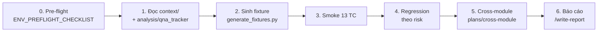

# 📁 Practices — Tài Liệu Thực Hành Kiểm Thử PARSCA Vendor

> Thư mục chứa **tài liệu thực hành** (requirements, Jira mẫu, phân tích, test plan, test cases, fixture) cho **role Vendor** của marketplace **PARSCA**, sinh theo quy trình **AI-RBT (Risk-Based Testing)**. Cấu trúc mirror `practices/` của **antigravity-testing-kit-main**.
>
> Nguồn nghiệp vụ: `docs/parsca-vendor-test-docs/` (doc 00–20). Prompt quy trình: `plans/`. Rules / skills / workflows: `.agent/`.

---

## 🌐 Môi Trường Kiểm Thử

### 🔹 PARSCA — Marketplace phụ tùng (role Vendor)

| Thông tin | Chi tiết |
| --------- | -------- |
| **FE URL** | `{FE_URL}` — biến `FE_URL` trong `.env` (KHÔNG commit) |
| **API URL** | `{API_URL}` — biến `API_URL` trong `.env` |
| **Tài khoản** | `${ADMIN_EMAIL}`, `${VENDOR1_EMAIL}`, `${VENDOR2_EMAIL}`, `${USER_EMAIL}`, `${ROLE_TEST_EMAIL}` (+ `*_PASSWORD`) — xin team, lưu trong `.env`; xem `.agent/rules/test-data.md` |
| **Dữ liệu tham chiếu** | `${V2_PRODUCT_SKU}`, `${V2_PRODUCT_SLUG}`, `${ADMIN_PRODUCT_SKU}` — chuẩn bị theo `context/ENV_PREFLIGHT_CHECKLIST.md` |
| **Mô tả** | Vendor tự quản lý sản phẩm của mình (danh sách, form, ảnh, trạng thái, import CSV), hồ sơ, storefront; các màn Dashboard / Orders / Reviews / Payouts / Settings là **[GIẢ LẬP]** |

> [!WARNING]
> Không ghi email / mật khẩu / token thật vào bất kỳ file nào trong thư mục này. Chỉ dùng biến `${...}` / `{...}`. Truy vấn DB chỉ SELECT.

> [!IMPORTANT]
> FE gọi API có tiền tố `/v1` + `{data, meta}`, BE bản zip thì không → **xác nhận với Dev trước khi chạy** (doc 01, mục 0 của `context/ENV_PREFLIGHT_CHECKLIST.md`).

---

## 📂 Cấu Trúc Thư Mục

```
practices/
├── README.md                              # File này
├── .gitignore                             # test-data/generated/
│
├── requirements/                          # Tài liệu yêu cầu
│   ├── parsca-vendor/                     # Requirements theo nhóm module (từ doc 00–20)
│   │   ├── 01_requirements_auth_role_session.md         # ROLE · LOGIN · SESS
│   │   ├── 02_requirements_access_control_data_scope.md # API · SCOPE
│   │   ├── 03_requirements_product_management.md        # PLIST · PDTL · PFORM · PSTAT · IMG
│   │   ├── 04_requirements_import_csv.md                # CSV
│   │   ├── 05_requirements_simulated_screens.md         # DASH · ORD · ORDD · REV · PAY · SET [GIẢ LẬP]
│   │   └── 06_requirements_profile_storefront.md        # PROF · WEB
│   └── jira/                              # Jira MẪU (key giả PVEN-*) — đầu vào cho /gen-testcase
│       ├── PVEN-1/                        # EPIC Quản lý sản phẩm vendor
│       │   ├── PVEN-1_overview.md
│       │   ├── PVEN-2/                    # Story: Thêm / sửa sản phẩm + ảnh
│       │   ├── PVEN-3/                    # Story: Import CSV
│       │   ├── PVEN-4/                    # Story: Danh sách, trạng thái, xoá
│       │   └── PVEN-5/                    # Story: Phạm vi dữ liệu + phân quyền API
│       └── PVEN-10/                       # EPIC Truy cập & phiên
│           ├── PVEN-10_overview.md
│           ├── PVEN-11/                   # Story: Cấp / thu hồi role
│           ├── PVEN-12/                   # Story: Đăng nhập & điều hướng
│           └── PVEN-13/                   # Story: Phiên & đăng xuất
│
├── context/                               # Bối cảnh dự án (Bước 1 AI-RBT)
│   ├── PROJECT_CONTEXT.md                 # Hệ thống, role, môi trường, nhãn doc
│   ├── TEST_STRATEGY.md                   # Chiến lược, mức ưu tiên, quy ước kết quả
│   └── ENV_PREFLIGHT_CHECKLIST.md         # Kiểm tra môi trường trước khi chạy
│
├── analysis/                              # Phân tích yêu cầu (Bước 2 AI-RBT)
│   ├── requirement_analysis_vendor.md     # Phân rã AC, rủi ro, mâu thuẫn
│   └── qna_tracker.md                     # Câu hỏi PO/Dev (Q-V*, Q-AUTH-*)
│
├── test_plan/
│   └── test_plan_vendor.md                # 53 scenarios, phạm vi, lịch, tiêu chí vào/ra
│
├── testcases/
│   ├── vendor/                            # Manual TC — AI-RBT Full Mode (12 cột)
│   │   ├── TC_PARSCA_VENDOR_01_AUTH_ROLE_SESSION.md   (+ .xlsx)
│   │   ├── TC_PARSCA_VENDOR_02_DATA_SCOPE.md          (+ .xlsx)
│   │   ├── TC_PARSCA_VENDOR_03_PRODUCT_LIST_DETAIL_STATUS.md (+ .xlsx)
│   │   ├── TC_PARSCA_VENDOR_04_PRODUCT_FORM_IMAGE.md  (+ .xlsx)
│   │   ├── TC_PARSCA_VENDOR_05_IMPORT_CSV.md          (+ .xlsx)
│   │   ├── TC_PARSCA_VENDOR_06_SIMULATED_SCREENS.md   (+ .xlsx)
│   │   ├── TC_PARSCA_VENDOR_07_PAYOUTS.md             (+ .xlsx)
│   │   └── TC_PARSCA_VENDOR_08_PROFILE_STOREFRONT.md  (+ .xlsx)
│   └── api/
│       └── API_TC_PARSCA_VENDOR.md        # API TC (6 cột) (+ .xlsx)
│
├── scripts/
│   └── generate_fixtures.py               # Sinh fixture (chỉ stdlib Python 3.8+)
│
└── test-data/
    ├── csv/                               # 26 file fixture nhỏ (25 .csv + 1 .txt) — commit được
    └── generated/                         # File lớn / đã thay placeholder / ảnh — gitignore
```

---

## 📝 Nội Dung Chính

### 1. Requirements (`requirements/`)

- **`parsca-vendor/`** — 6 tài liệu yêu cầu theo nhóm module, mỗi file gồm: tổng quan, AC (`AC-<MOD>-NN`), đặc tả trường, luồng xử lý, thông báo lỗi, cấu trúc giao diện, NFR, câu hỏi PO.
- **`jira/`** — 2 EPIC + 7 Story **mẫu** theo format Jira của kit gốc (`KAN-5`). AC giữ nguyên ID gốc để truy vết. ⚠️ Key `PVEN-*` là giả, Attachments = 0.

### 2. Context & Analysis (`context/`, `analysis/`)

Đầu ra Bước 1–2 của AI-RBT: bối cảnh, chiến lược, checklist môi trường, phân rã AC và bảng câu hỏi mở. **Đọc trước khi chạy test.**

### 3. Test Cases (`testcases/`)

**Manual — 262 TC** (AI-RBT Full Mode, 12 cột: 9 field chuẩn + Automatable / Auto Type / Tags):

| File | Module (số TC) | Tổng |
|------|----------------|-----:|
| `01_AUTH_ROLE_SESSION` | ROLE 9 · LOGIN 18 · SESS 9 | 36 |
| `02_DATA_SCOPE` | SCOPE 14 | 14 |
| `03_PRODUCT_LIST_DETAIL_STATUS` | PLIST 20 · PDTL 7 · PSTAT 11 | 38 |
| `04_PRODUCT_FORM_IMAGE` | PFORM 52 · IMG 8 | 60 |
| `05_IMPORT_CSV` | CSV 28 | 28 |
| `06_SIMULATED_SCREENS` | DASH 4 · ORD 9 · ORDD 11 · REV 8 · SET 6 | 38 |
| `07_PAYOUTS` | PAY 26 | 26 |
| `08_PROFILE_STOREFRONT` | PROF 13 · WEB 9 | 22 |
| **Tổng** | | **262** |

**API — 78 TC** (`API_TC_PARSCA_VENDOR.md`): PERM 30 · PROD 22 · SCOPE 10 · FILE 8 · AUTH 5 · SEC 3. Priority P1 / P2 / P3 = 47 / 23 / 8.

Mỗi file có: Risk assessment, Traceability Matrix (AC ↔ TC), kỹ thuật (EP, BVA, Decision Table, State Transition) và bản **Excel `.xlsx`** cùng tên.

### 4. Fixture (`scripts/`, `test-data/`)

```bash
# Chạy từ thư mục kit-test-parsca/
export V2_PRODUCT_SKU=...        # SKU 1 sản phẩm của Vendor 2
export ADMIN_PRODUCT_SKU=...     # SKU 1 sản phẩm do Admin tạo
# (tuỳ chọn) SHARED_IMAGE_URL=<URL ảnh /public/uploads/...>, RUN_SUFFIX=<hậu tố SKU file lớn>
python3 practices/scripts/generate_fixtures.py               # đầy đủ (~58 MB trong generated/)
python3 practices/scripts/generate_fixtures.py --skip-large  # bỏ CSV 50.000 dòng / 20 MB, ảnh 10–11 MB
python3 practices/scripts/generate_fixtures.py --csv-only    # chỉ sinh lại test-data/csv/
```

| Nhóm | File | Dùng cho |
|------|------|----------|
| `csv/` (commit) | `csv_valid_5_rows*.csv`, `csv_partial_update_blank_cells.csv`, `csv_mixed_valid_invalid.csv`, `csv_missing_*.csv`, `csv_stockcount_zero*.csv`, `csv_dup_sku_in_file.csv`, `csv_empty.csv`, `csv_header_only.csv`, `csv_not_csv.txt`, `csv_fake_header_column1.csv`, `csv_status_draft.csv`, `csv_bom_multiline.csv`, `csv_column_case_unknown.csv`, `csv_images_links.csv`, `csv_new_brand_vehicle.csv`, `csv_extra_columns.csv` | CSV_TC_001–028 |
| `csv/` (commit) | `scope_sku_other_vendor.csv` (có placeholder), `pstat_shared_image.csv`, `plist_seed_25_products.csv` | SCOPE_TC_010, PSTAT_TC_010, seed PLIST |
| `generated/` | `csv_sku_other_vendor.csv`, `csv_sku_admin.csv`, `scope_sku_other_vendor.csv` (đã thay SKU thật) | CSV_TC_017–018, SCOPE_TC_010 |
| `generated/` | `csv_50000_rows.csv`, `csv_50001_rows.csv`, `csv_over_20mb.csv` (21.500.000+ B), `csv_valid_5_rows.xlsx` | CSV_TC_011, 013, 014 |
| `generated/` | `img_ok_200kb.png`, `avatar_ok_200kb.png` (204.800 B), `img_ok.jpg/.webp/.gif` | PFORM, IMG, PROF |
| `generated/` | `img_10mb_decimal.png` (10.000.000 B), `img_exact_10mib.png` (10.485.760 B), `img_11mb.png` (11.534.336 B) | BVA 10 MB (Q-V14) |
| `generated/` | `img_vector.svg`, `img_photo.heic` (header giả), `doc_sample.pdf`, `fake_image_text.png` | Sai loại file |

> [!NOTE]
> - Ảnh PNG là ảnh hợp lệ (400×300), kích thước byte chính xác nhờ chunk phụ `prVt`. JPEG / WebP / GIF là ảnh hợp lệ tối giản.
> - `csv_images_links.csv`, `pstat_shared_image.csv` dùng link công khai `https://placehold.co/...` — nếu môi trường chặn link ngoài, thay bằng link team cung cấp (hoặc đặt `SHARED_IMAGE_URL`).
> - CSV import luôn tạo sản phẩm **Active** và stockCount ≥ 1 → seed PLIST cần đổi trạng thái (15 Active / 6 Draft / 4 Archived) bằng UI sau khi import; sản phẩm stockCount = 0 phải lấy từ dữ liệu cũ.

---

## 🚀 Thứ Tự Thực Hiện



### Smoke (13 TC — chạy trước mỗi đợt)

| # | TC ID | Nội dung | Priority |
|---|-------|----------|----------|
| 1 | `PARSCA_ROLE_TC_001` | Admin nâng user thành vendor qua `/admin/users` | Critical |
| 2 | `PARSCA_LOGIN_TC_001` | Vendor đăng nhập thành công, vào `/vendor` | Critical |
| 3 | `PARSCA_LOGIN_TC_010` | Ma trận chặn truy cập — Vendor | Critical |
| 4 | `PARSCA_SCOPE_TC_001` | V1 chỉ thấy sản phẩm của chính V1 | Critical |
| 5 | `PARSCA_SCOPE_TC_003` | V1 mở chi tiết sản phẩm V2 bằng URL trực tiếp | Critical |
| 6 | `PARSCA_PLIST_TC_001` | Danh sách mặc định chỉ hiện Active, bố cục đúng | High |
| 7 | `PARSCA_PFORM_TC_003` | Tạo sản phẩm tối thiểu thành công | Critical |
| 8 | `PARSCA_PSTAT_TC_001` | Đổi Active → Draft: toast, rời bộ lọc, ẩn khỏi website | Critical |
| 9 | `PARSCA_PSTAT_TC_006` | Xoá sản phẩm từ danh sách — xoá vĩnh viễn | Critical |
| 10 | `PARSCA_CSV_TC_004` | Import thật file hợp lệ 5 dòng | Critical |
| 11 | `PARSCA_WEB_TC_001` | Sản phẩm Active hiện ngay trên website | Critical |
| 12 | `PARSCA_SESS_TC_004` | Đăng xuất — cookie cũ gọi API bị 401 | Critical |
| 13 | `API_PERM_TC_005` | Vendor `POST /product-brands` → 403 | P1 |

### Regression (theo risk)

`02 DATA_SCOPE` + `API` → `01 AUTH_ROLE_SESSION` → `04 PRODUCT_FORM_IMAGE` → `05 IMPORT_CSV` → `03 PRODUCT_LIST_DETAIL_STATUS` → `08 PROFILE_STOREFRONT` → `07 PAYOUTS` → `06 SIMULATED_SCREENS`

### Cách ghi kết quả

| Kết quả | Khi nào |
|---------|---------|
| **PASS** | Đúng Expected Result |
| **FAIL** | Sai Expected Result → `/analyze-bug` |
| **OBSERVED** | TC tag `@CodeHienTai` — hành vi theo code hiện tại, chờ PO trả lời Q-V*; **không** PASS |
| **@SuyLuan** | Expected suy luận từ code → ghi nhận thực tế, xác nhận với Dev |
| **@GiaLap** | Màn giả lập: "không lưu / không gọi API" = PASS, không ghi bug |
| **BLOCKED** | Thiếu môi trường / dữ liệu / quyền (ghi rõ lý do) |

---

## ⚡ Hướng Dẫn Sử Dụng (Slash Commands của kit)

> Mở **`kit-test-parsca/`** làm workspace root để Antigravity nhận `.agent/`.

### Sinh / bổ sung Test Cases

```
/gen-testcase Mode FULL cho practices/requirements/jira/PVEN-1/PVEN-3/PVEN-3_requirement.md
/gen-testcase Mode QUICK cho docs/parsca-vendor-test-docs/12-import-csv.md
```

### Xuất Excel

```bash
# Chạy từ kit-test-parsca/ — cần `npm install` 1 lần trong scripts/convert_excel/
node scripts/convert_excel/md_to_xlsx.js practices/testcases/vendor/TC_PARSCA_VENDOR_<MOD>.md
node scripts/convert_excel/md_to_xlsx.js practices/testcases/vendor            # cả thư mục
node scripts/convert_excel/md_to_xlsx.js practices/testcases/api --summary     # API 6 cột + sheet Summary
```

> Converter của kit ([scripts/convert_excel](../scripts/convert_excel/README.md)) tự nhận dạng bảng manual **12 cột** (sheet `Test Cases`) và bảng API **6 cột** (sheet `API Test Cases`); `--core` để xuất 9 cột như script gốc. Upload lên Google Sheets / Xray: xem [scripts/integrations](../scripts/integrations/).

### Chuyển Manual → Automation

```
/gen-script tests cho các TC @Smoke trong practices/testcases/vendor/TC_PARSCA_VENDOR_02_DATA_SCOPE.md
/review-script tests/vendor/csv.import.spec.ts so với practices/testcases/vendor/TC_PARSCA_VENDOR_05_IMPORT_CSV.md
```

### Bug · Báo cáo · Dữ liệu

```
/analyze-bug   V1 mở /vendor/products/<id V2> thấy dữ liệu sản phẩm (đính kèm HAR)
/write-report  sprint hiện tại từ kết quả smoke + regression
/analyze-log   ANM-03 — kiểm tra SKU trùng sau import
```

---

## 🔗 Liên Kết Hữu Ích

| Tài liệu | Đường dẫn |
| -------- | --------- |
| Agent kit (rules, skills, workflows) | `.agent/README.md` |
| Quy trình AI-RBT Manual | `plans/manual/QUICK_START.md` |
| Quy trình Automation | `plans/automation/QUICK_START.md` |
| Ma trận cross-module (21 combo LC) | `plans/cross-module/QUICK_START.md` |
| Chuẩn test data | `.agent/rules/test-data.md` |
| Tài liệu BA gốc | `docs/parsca-vendor-test-docs/README.md` |

---

## 🗂️ Nguồn & Thay Đổi So Với Bản Cũ

Nội dung chuyển (copy) từ `antigravity-testing-kit-main/parsca-vendor-test-kit/` (bản cũ giữ nguyên), đã chuẩn hoá:

- **Đường dẫn:** mọi tham chiếu tính từ gốc `kit-test-parsca/` (`practices/...`, `docs/...`, `plans/...`, `.agent/...`).
- **Thống kê đếm lại và sửa:** file 01 (Automatable 27/8/1), 03 (Medium 22, Low 9), 04 (High 16, Medium 33, Low 8), 06 (High 3, Low 20), 08 (Automatable 19/3/0), API (PERM 16/9/5, PROD 12/8/2, FILE 6/2/0; tổng 47/23/8).
- **Smoke:** ID API sửa thành `API_PERM_TC_005` (bản cũ ghi `PARSCA_API_PERM_TC_005`).
- **Fixture:** bổ sung `generate_fixtures.py` + `test-data/csv/` (bản cũ chỉ tham chiếu, chưa có file); thêm `csv_stockcount_zero_all.csv` cho CSV_TC_003 (N = 0); SCOPE_TC_010 dùng bản đã thay placeholder trong `generated/`.
- **Mới:** Jira mẫu `requirements/jira/PVEN-*`, file Excel cho 8 file manual + 1 file API.

---

> **kit-test-parsca** — Bộ kiểm thử AI-RBT cho role Vendor PARSCA 🚀
