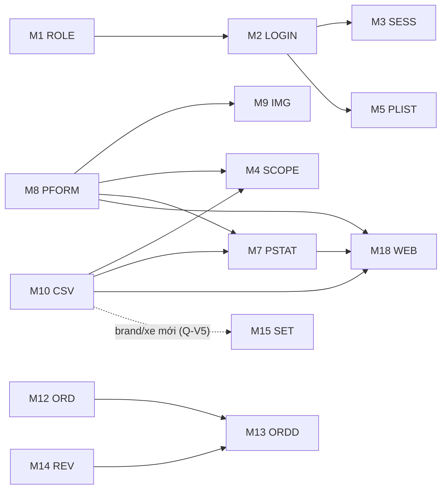

# 📋 TEST PLAN — PARSCA ROLE VENDOR

| Thông tin | Chi tiết |
|-----------|----------|
| **Dự án** | PARSCA — Marketplace phụ tùng (Marine, Auto, Door, Tools) |
| **Phạm vi** | Role Vendor (đối chiếu User, Admin, Không token) |
| **Workflow** | `/generate_application_test_plan` (kit gốc) — Mode **PLAN** (dựng từ tài liệu BA; chưa recon trên môi trường thật) |
| **Nguồn** | `docs/parsca-vendor-test-docs/` 00–20 |
| **Ngày tạo** | 2026-10-20 |
| **Phiên bản** | 1.0 — chờ xác nhận môi trường (D-01, D-02) |

> [!IMPORTANT]
> Recon (Bước 1 của workflow) **chưa thực hiện được** vì chưa có URL môi trường test. Test plan dựng từ tài liệu BA (viết từ đọc code). Sau khi có URL → chạy `practices/context/ENV_PREFLIGHT_CHECKLIST.md`, rồi cập nhật plan này nếu UI thực tế khác tài liệu.

---

## 1. Tổng Quan Ứng Dụng

| Mục | Nội dung |
|-----|----------|
| Mục đích | Marketplace phụ tùng; vendor tự quản lý sản phẩm của mình (tạo / sửa / đổi trạng thái / xoá / import CSV); sản phẩm Active hiển thị ngay trên website |
| Tech stack | FE: React SPA (route `/vendor/*`, `/admin/*`, storefront) · BE: NestJS REST, JWT trong cookie httpOnly, Redis cache (tuỳ môi trường) |
| URL | `{FE_URL}` (FE), `{API_URL}` (BE) — chờ Dev (D-01) |
| Đặc thù | Nhiều màn **[GIẢ LẬP]** (Dashboard, Orders, Reviews, Payouts, Settings, một phần Profile); FE dùng `/v1` + `{data, meta}` khác BE zip (Doc 01) |
| Vai trò | Không token · User · **Vendor** · Admin |

---

## 2. Phạm Vi (Scope)

### 2.1. Trong phạm vi
- Cấp/thu hồi role vendor, đăng nhập & điều hướng, phiên & đăng xuất
- Phân quyền API (3 nhóm) và **phạm vi dữ liệu `createdBy`**
- Quản lý sản phẩm: danh sách, chi tiết, thêm/sửa, upload ảnh, đổi trạng thái, xoá, Import CSV
- Màn giả lập: kiểm tra hiển thị + không gọi API cấm + ghi nhận lỗ hổng
- Hồ sơ vendor (avatar thật), Forgot password
- Vòng đời sản phẩm vendor trên website (E2E)

### 2.2. Ngoài phạm vi
- Thanh toán thật (Tipalti), đơn hàng thật (chưa có API)
- Hiệu năng tải lớn (load test), bảo mật hạ tầng (pentest)
- Role Admin ngoài các điểm đối chiếu với vendor

---

## 3. Danh Sách Modules

| # | Module | Mô tả | Risk Level | Số scenarios | Manual TC | File TC |
|---|--------|-------|-----------|--------------|-----------|---------|
| M1 | ROLE | Cấp / thu hồi role vendor | 🔴 High | 3 | 9 | 01 |
| M2 | LOGIN | Đăng nhập & guard theo role | 🔴 High | 4 | 18 | 01 |
| M3 | SESS | Refresh, logout, đa tab | 🔴 High | 3 | 9 | 01 |
| M4 | SCOPE | Phạm vi dữ liệu `createdBy` | 🔴 High | 4 | 14 | 02 |
| M5 | PLIST | Danh sách sản phẩm | 🟡 Medium | 3 | 20 | 03 |
| M6 | PDTL | Chi tiết sản phẩm | 🟢 Low | 1 | 7 | 03 |
| M7 | PSTAT | Đổi trạng thái & xoá | 🔴 High | 3 | 11 | 03 |
| M8 | PFORM | Thêm / sửa sản phẩm | 🔴 High | 5 | 52 | 04 |
| M9 | IMG | Upload ảnh (API) | 🟡 Medium | 2 | 8 | 04 |
| M10 | CSV | Import CSV | 🔴 High | 5 | 28 | 05 |
| M11 | DASH | Dashboard (giả lập) | 🟢 Low | 1 | 4 | 06 |
| M12 | ORD | Danh sách đơn (giả lập) | 🟢 Low | 2 | 9 | 06 |
| M13 | ORDD | Chi tiết đơn (giả lập) | 🟡 Medium | 2 | 11 | 06 |
| M14 | REV | Đánh giá (giả lập) | 🟢 Low | 1 | 8 | 06 |
| M15 | SET | Settings Brand & Fitment (giả lập) | 🟢 Low | 2 | 6 | 06 |
| M16 | PAY | Payouts (giả lập hoàn toàn) | 🟡 Medium | 3 | 26 | 07 |
| M17 | PROF | Hồ sơ vendor | 🟡 Medium | 3 | 13 | 08 |
| M18 | WEB | Vendor trên website | 🔴 High | 2 | 9 | 08 |
| API | API | Ma trận quyền & validation | 🔴 High | 4 | 78 (API) | `practices/testcases/api/` |
| | **Tổng** | | | **53** | **262 + 78 API** | |

### 3.1. Dependencies giữa modules

---

## 4. User Flows Chính

| # | Flow | Các bước | Module |
|---|------|----------|--------|
| UF-01 | Trở thành vendor | Admin đổi role user → vendor → user đăng nhập → vào `/vendor` | ROLE, LOGIN |
| UF-02 | Tạo sản phẩm bằng form | `/vendor/products` → Add product → nhập (a)–(f) + 1–5 ảnh → Add Product → toast "Saved" → website hiển thị | PFORM, IMG, WEB |
| UF-03 | Import CSV | Import CSV → Template → chọn file → Check file → Import N row(s) → toast → danh sách | CSV, SCOPE, WEB |
| UF-04 | Quản lý trạng thái | Danh sách → ô Status → Draft/Archived/Active → website ẩn/hiện | PSTAT, WEB |
| UF-05 | Xoá sản phẩm | Thùng rác → "Delete product?" → Delete → 204 → website 404 | PSTAT, WEB |
| UF-06 | Cô lập dữ liệu | V1 thử xem/sửa/xoá sản phẩm V2 qua URL/API → 404 | SCOPE, API |
| UF-07 | Phiên làm việc | Đăng nhập → access hết hạn → refresh tự động → logout → cookie cũ 401 | SESS |
| UF-08 | Xem đơn / đánh giá (giả lập) | Orders → lọc → chi tiết đơn; Reviews → bấm dòng → đơn | ORD, ORDD, REV |
| UF-09 | Thiết lập Payouts (giả lập) | Set up payouts → Address → Payment → Tax W-8BEN → Done → Manage | PAY |
| UF-10 | Hồ sơ & mật khẩu | Đổi avatar → Forgot password → reset → mọi phiên đăng xuất | PROF |

---

## 5. Test Scenarios

| ID | Module | Scenario | Priority | Loại |
|----|--------|----------|----------|------|
| SC-01 | ROLE | Admin cấp role vendor, user vào được `/vendor` | P1 | Happy |
| SC-02 | ROLE | Hạ vendor → mất quyền API ngay, `vendorId` null | P1 | Edge |
| SC-03 | ROLE | User/vendor tự đổi role qua API → 403 | P1 | Negative |
| SC-04 | LOGIN | Vendor đăng nhập → `/vendor`; guard `/admin` → `/vendor` | P1 | Happy |
| SC-05 | LOGIN | Sai email/mật khẩu, mật khẩu < 8 ký tự | P2 | Negative |
| SC-06 | LOGIN | Rate limit 5 lần/phút → 429 | P2 | Edge |
| SC-07 | LOGIN | BE lỗi 5xx → trạng thái "không khả dụng", không đá ra `/login` | P3 | Edge |
| SC-08 | SESS | Refresh tự động một lần; nhiều request dùng chung | P1 | Happy |
| SC-09 | SESS | Logout → cookie cũ 401; dùng lại refresh token → huỷ phiên | P1 | Negative |
| SC-10 | SESS | Upload gặp 401 không tự gửi lại | P2 | Edge |
| SC-11 | SCOPE | Vendor chỉ thấy sản phẩm của mình | P1 | Happy |
| SC-12 | SCOPE | Xem/sửa/xoá sản phẩm người khác → 404 (UI + API) | P1 | Negative |
| SC-13 | SCOPE | `vendorName`, mass assignment `createdBy` bị bỏ qua/400 | P1 | Negative |
| SC-14 | SCOPE | Rò rỉ SKU qua 409 / lỗi import (Q-V4) | P2 | Edge |
| SC-15 | PLIST | Tìm kiếm, lọc department/trạng thái, sắp xếp | P2 | Happy |
| SC-16 | PLIST | Phân trang, `limit` ≤ 100, trạng thái rỗng | P3 | Edge |
| SC-17 | PLIST | Lỗi tải danh sách "Failed to load products." | P3 | Negative |
| SC-18 | PDTL | Hiển thị chi tiết đủ thông tin, huy hiệu cố định | P3 | Happy |
| SC-19 | PSTAT | Đổi trạng thái từ danh sách, toast, website ẩn/hiện | P1 | Happy |
| SC-20 | PSTAT | Xoá có xác nhận, dọn ảnh, 404 sau xoá | P1 | Happy |
| SC-21 | PSTAT | Xoá sản phẩm đã có đơn (Q-V6) | P3 | Edge |
| SC-22 | PFORM | Tạo sản phẩm tối thiểu / đầy đủ | P1 | Happy |
| SC-23 | PFORM | Validation từng trường bắt buộc | P1 | Negative |
| SC-24 | PFORM | Biên Price, Stock count, Rating, số ảnh | P2 | Edge |
| SC-25 | PFORM | Sửa sản phẩm, trùng SKU/slug 409 | P1 | Negative |
| SC-26 | PFORM | Rời form chưa lưu, ảnh mồ côi, double click | P3 | Edge |
| SC-27 | IMG | Upload ảnh hợp lệ / sai loại / > 10 MB | P2 | Negative |
| SC-28 | IMG | Phân quyền upload (user 403, không token 401) | P2 | Negative |
| SC-29 | CSV | Check file + Import 5 dòng, import lại không nhân đôi | P1 | Happy |
| SC-30 | CSV | Lỗi file: loại, dung lượng, số dòng, thiếu cột, rỗng | P2 | Negative |
| SC-31 | CSV | Lỗi dòng: stockCount 0, SKU lặp, SKU người khác | P1 | Negative |
| SC-32 | CSV | Status bỏ qua (luôn Active), brand mới vào danh mục (Q-V5, Q-V17) | P1 | Edge |
| SC-33 | CSV | Mất mạng / 401 / đổi file / đóng hộp thoại giữa chừng | P2 | Edge |
| SC-34 | DASH | Hiển thị giả lập; không khối Catalogue; không gọi `/dashboard/stats` | P2 | Happy |
| SC-35 | ORD | Lọc / tìm / phân trang 20 đơn mẫu | P3 | Happy |
| SC-36 | ORD | Mọi vendor thấy cùng đơn (Q-V8) | P2 | Edge |
| SC-37 | ORDD | 6 trạng thái đơn × nút Cancel | P3 | Happy |
| SC-38 | ORDD | Đơn không tồn tại; khách mở đơn mẫu lộ PII (Q-V8) | P2 | Negative |
| SC-39 | REV | Lọc sao / tìm / thời gian / bấm dòng | P3 | Happy |
| SC-40 | SET | Chỉ 2 mục; URL logo/blog chuyển về Brand | P2 | Negative |
| SC-41 | SET | Dữ liệu giả lập, không ảnh hưởng form/website | P3 | Edge |
| SC-42 | PAY | Trang chính 3 thẻ + bảng + Manage | P3 | Happy |
| SC-43 | PAY | Wizard: validation bước 1, 2, toast bước 3 | P2 | Negative |
| SC-44 | PAY | Lỗ hổng kiểm tra dữ liệu + rủi ro PII | P2 | Edge |
| SC-45 | PROF | Avatar hợp lệ / sai loại / biên 10 MB | P2 | Negative |
| SC-46 | PROF | Thông tin cá nhân, Devices giả lập; không đổi mật khẩu | P3 | Happy |
| SC-47 | PROF | Forgot password: link 1 giờ, huỷ mọi phiên, link dùng lại | P1 | Edge |
| SC-48 | WEB | Vòng đời Active → Draft → Active → Archived → Xoá | P1 | Happy |
| SC-49 | WEB | category-counts / bộ lọc / cache cập nhật | P2 | Edge |
| SC-50 | API | Ma trận 4 vai cho Nhóm 1/2/3 | P1 | Negative |
| SC-51 | API | Validation body sản phẩm, trường lạ 400 | P1 | Negative |
| SC-52 | API | Phiên: cookie flags, refresh xoay vòng, rate limit | P1 | Edge |
| SC-53 | API | JSON hỏng, Content-Type sai, race condition SKU | P2 | Edge |

---

## 6. Automation Candidates

| Ưu tiên | Scenarios | Lý do | Loại |
|---------|-----------|-------|------|
| ⭐⭐⭐ | SC-11, SC-12, SC-13, SC-50, SC-51 | Bảo mật cốt lõi, ổn định, chạy nhanh qua API — chặn regression rò rỉ dữ liệu | API (Playwright `request` / REST Assured) |
| ⭐⭐⭐ | SC-01, SC-04, SC-22, SC-29, SC-48 | Critical path E2E (Smoke) | UI Playwright |
| ⭐⭐ | SC-19, SC-20, SC-23, SC-24, SC-25, SC-31 | Regression nhiều dữ liệu (data-driven từ `test_data_vendor.json`) | UI + API |
| ⭐⭐ | SC-08, SC-09, SC-52 | Phiên — dễ hỏng khi đổi auth | API |
| ⭐ | SC-34, SC-40, SC-43 | Giả lập — sẽ thay đổi khi nối API thật → automation tạm, chi phí bảo trì cao | UI |
| ❌ | SC-07, SC-21, SC-33 (mất mạng), SC-47, SC-44 | Cần Dev hỗ trợ (tắt BE, rút TTL, hộp thư) hoặc đánh giá thủ công | Manual |

> Thứ tự triển khai automation: xem `plans/automation/README.md` (Thứ tự tự động hoá) và `plans/automation/prompt_automation.txt` (`/gen-script`).

---

## 7. Chiến Lược Thực Thi

| Giai đoạn | Nội dung | Tiêu chí vào | Tiêu chí ra |
|-----------|----------|--------------|-------------|
| 0. Pre-flight | `ENV_PREFLIGHT_CHECKLIST.md` | Có URL + tài khoản | 100% mục ☑ |
| 1. Smoke | 12 TC Smoke (`practices/README.md`) | Pre-flight pass | 12/12 Pass (trừ TC `@CodeHienTai`) |
| 2. Security & Scope | SCOPE + API PERM/SCOPE | Smoke pass | 0 lỗi Critical rò rỉ dữ liệu |
| 3. Functional | PFORM, PSTAT, PLIST, CSV, IMG, PROF, WEB | Giai đoạn 2 xong | ≥ 95% Pass; bug Critical/High đã báo |
| 4. Simulated | DASH, ORD, ORDD, REV, SET, PAY | – | Báo cáo ghi nhận cho BA |
| 5. Cross-module | 21 combo pairwise (`plans/cross-module/`, chạy `scripts/pairwise_product_lifecycle.py`) | Giai đoạn 3 xong | Mọi combo có kết quả |
| 6. Regression | Toàn bộ `@Regression` + API | Bản fix mới | Không regression |

### 7.1. Tiêu chí dừng (Suspension)
- Mọi API lỗi 404 / sai định dạng dữ liệu (Doc 01) → dừng, báo Dev
- Không đăng nhập được bằng tài khoản vendor → dừng

### 7.2. Rủi ro kế hoạch

| Rủi ro | Ảnh hưởng | Giảm thiểu |
|--------|-----------|------------|
| FE/BE lệch `/v1` | Chặn toàn bộ | Pre-flight bước 4–5 trước khi chạy |
| Chưa có câu trả lời PO (Q-V2…Q-V17) | TC chỉ OBSERVED | `qna_tracker.md` + `/gen-testcase` cập nhật lại |
| Dữ liệu dùng chung giữa tester | TC phụ thuộc | SKU hậu tố ngày/timestamp, dọn dữ liệu `AUTO-*` |
| Cần Dev (TTL, Redis, tắt BE, hộp thư) | TC `@NeedDevSupport` bị chặn | Đặt lịch với Dev; đánh dấu Blocked |

---

## 8. Deliverables

| Deliverable | Vị trí |
|-------------|--------|
| Manual TC (8 file + Excel) | `practices/testcases/vendor/` |
| API TC | `practices/testcases/api/API_TC_PARSCA_VENDOR.md` |
| Ma trận cross-module | `plans/cross-module/` |
| Báo cáo thực thi | `.agent/skills/write-test-report/SKILL.md` (`/write-report`) |
| Bug report | `.agent/skills/analyze-bug/SKILL.md` (`/analyze-bug`) |
| Traceability | Mục TRACEABILITY MATRIX trong từng file `practices/testcases/vendor/` |
