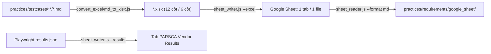

# 📊 Google Sheets Integration — PARSCA Vendor Kit

> Bộ scripts Node.js kết nối `kit-test-parsca` với Google Sheets API — upload bộ test case PARSCA Vendor (`.xlsx`), ghi kết quả Playwright theo quy ước PARSCA (`PASS / FAIL / OBSERVED / BLOCKED / SKIP`), và đọc ngược sheet về Markdown.
>
> Chuyển thể từ [`scripts/integrations/google_sheet`](../../../../scripts/integrations/google_sheet/README.md) của Antigravity Testing Kit.

---

## 📁 Cấu trúc thư mục

```
kit-test-parsca/scripts/
├── common/
│   └── parsca_catalog.js          # Catalog module M1–M18, TC ID, tag, trạng thái PARSCA (dùng chung)
└── integrations/
    └── google_sheet/              # Self-contained Google Sheets integration
        ├── sheet_auth.js          # Kiểm tra xác thực và kết nối
        ├── sheet_reader.js        # Đọc dữ liệu từ Google Sheets → JSON / Markdown
        ├── sheet_writer.js        # Upload Excel test case / ghi kết quả test
        ├── utils.js               # Hàm utility dùng chung (RESULT_HEADERS, STATUS_COLORS…)
        ├── .env.example           # Template biến môi trường
        ├── .env                   # Biến môi trường thực tế (KHÔNG commit)
        ├── service-account.json   # Service Account key (KHÔNG commit)
        ├── package.json           # Dependencies (googleapis, dotenv, xlsx)
        ├── package-lock.json      # Lock file (BẮT BUỘC commit)
        ├── node_modules/          # (auto-generated)
        └── README.md              # Tài liệu hướng dẫn (file này)
```

> 💡 Mọi lệnh trong README chạy từ thư mục gốc **`kit-test-parsca/`** (trừ khi ghi rõ `cd`).

---

## 🔗 Vị trí trong luồng PARSCA



| Nguồn | Script | Đích |
|-------|--------|------|
| `practices/testcases/vendor/*.xlsx` (8 file, 262 TC) | `sheet_writer.js --excel <DIR>` | Mỗi file → 1 tab cùng tên file |
| `practices/testcases/api/API_TC_PARSCA_VENDOR.xlsx` (78 TC) | `sheet_writer.js --excel <FILE>` | Tab `API_TC_PARSCA_VENDOR` |
| `test-results/results.json` (Playwright JSON reporter) | `sheet_writer.js --results` | Tab `PARSCA Vendor Results` |
| Bất kỳ tab nào | `sheet_reader.js` | `practices/requirements/google_sheet/` |

---

## ⚡ Cài đặt nhanh

### 1. Cài dependencies

```bash
cd scripts/integrations/google_sheet
npm install
```

> ⚠️ Thư mục này mới có `package-lock.json`, **chưa có `node_modules/`** — bắt buộc chạy `npm install` trước lần dùng đầu tiên.

### 2. Tạo file `.env`

```bash
cp .env.example .env
```

### 3. Cấu hình xác thực

Xem phần **[Cách lấy Credentials](#-cách-lấy-credentials)** bên dưới.

### 4. Verify kết nối

```bash
# Từ kit-test-parsca/
node scripts/integrations/google_sheet/sheet_auth.js --verify

# Verify + đọc thử một tab cụ thể
node scripts/integrations/google_sheet/sheet_auth.js --verify --sheet "TC_PARSCA_VENDOR_01_AUTH_ROLE_SESSION"
```

---

## 🔑 Cách lấy Credentials

### Phương pháp 1: Service Account (Khuyến nghị)

> Dùng cho automation, CI/CD pipeline. Hỗ trợ đầy đủ đọc & ghi.

**Bước 1: Tạo Google Cloud Project**

1. Truy cập: https://console.cloud.google.com/
2. Tạo project mới hoặc chọn project hiện có

**Bước 2: Bật Google Sheets API**

1. APIs & Services → Library
2. Tìm **"Google Sheets API"** → Click **Enable**

**Bước 3: Tạo Service Account** _(bỏ qua nếu đã có)_

1. APIs & Services → **Credentials** → **Create Credentials** → **Service Account**
2. Điền tên (VD: `parsca-vendor-automation`) → **Create and continue** → Done

**Bước 4: Tải file JSON Key** ⬅️ _Bước quan trọng_

1. **IAM & Admin** → **Service Accounts** → click tên Service Account
2. Tab **"Keys"** → **"Add key"** → **"Create new key"** → chọn **"JSON"** → **"Create"**
3. Đổi tên file vừa tải thành `service-account.json`
4. Di chuyển vào:
   ```
   kit-test-parsca/scripts/integrations/google_sheet/service-account.json
   ```

> ⚠️ File JSON chỉ tải được **đúng 1 lần** lúc tạo. Mất file → tạo key mới.

**Bước 5: Cấu hình file `.env`**

```env
GOOGLE_SERVICE_ACCOUNT_KEY_PATH=./service-account.json
GOOGLE_SPREADSHEET_ID=your-spreadsheet-id-here
RESULTS_SHEET_NAME=PARSCA Vendor Results
OUTPUT_DIR=practices/requirements/google_sheet
```

**Bước 6: Share Spreadsheet cho Service Account**

> Bắt buộc — nếu không, script báo lỗi `HTTP 403`.

1. Mở Google Spreadsheet chứa bộ test PARSCA Vendor → **"Share"**
2. Nhập `client_email` trong `service-account.json` (VD: `parsca-vendor-automation@your-project.iam.gserviceaccount.com`)
3. Cấp quyền **"Editor"** → **"Share"**

**Bước 7: Lấy Spreadsheet ID**

```
https://docs.google.com/spreadsheets/d/1BxiMVs0XRA5nFMdKvBdBZjgmUUqptlbs74OgVE2upms/edit
                                        ↑─────────────────────────────────────────────┘
                                                   Copy toàn bộ phần này
```

Dán vào `GOOGLE_SPREADSHEET_ID` trong `.env`.

---

### Phương pháp 2: API Key (Read-only)

> Chỉ dùng cho Sheet công khai — dùng được `sheet_reader.js`, **không** dùng được `sheet_writer.js`.

```env
GOOGLE_API_KEY=your-api-key-here
GOOGLE_SPREADSHEET_ID=your-spreadsheet-id
```

---

## 🚀 Sử dụng

### sheet_auth.js — Kiểm tra kết nối

```bash
node scripts/integrations/google_sheet/sheet_auth.js --setup
node scripts/integrations/google_sheet/sheet_auth.js --verify
node scripts/integrations/google_sheet/sheet_auth.js --verify --sheet "PARSCA Vendor Results"
```

| Option | Mô tả |
|--------|--------|
| `--verify` | Kiểm tra kết nối và liệt kê tất cả sheets |
| `--verify --sheet <NAME>` | Verify + đọc thử tab cụ thể (tồn tại & quyền đọc) |
| `--setup` | Hiển thị hướng dẫn cài đặt credentials chi tiết |

---

### sheet_writer.js — Upload test case / ghi kết quả

#### 📁 Upload test case Excel

File `.xlsx` được sinh bởi [`convert_excel/md_to_xlsx.js`](../../convert_excel/README.md) — manual 12 cột (sheet `Test Cases`), API 6 cột (sheet `API Test Cases`).

```bash
# 1) Sinh Excel từ Markdown (nếu chưa có / vừa sửa .md)
node scripts/convert_excel/md_to_xlsx.js practices/testcases/vendor

# 2a) Upload cả thư mục — mỗi file .xlsx → 1 tab cùng tên file
node scripts/integrations/google_sheet/sheet_writer.js --excel practices/testcases/vendor

# 2b) Upload 1 file — tên tab mặc định = tên file
node scripts/integrations/google_sheet/sheet_writer.js \
  --excel practices/testcases/vendor/TC_PARSCA_VENDOR_05_IMPORT_CSV.xlsx

# 2c) Upload bộ API TC vào tab tự đặt tên
node scripts/integrations/google_sheet/sheet_writer.js \
  --excel practices/testcases/api/API_TC_PARSCA_VENDOR.xlsx --sheet "API_TC"

# Upload tab Summary (tab thứ 2) của file sinh bằng md_to_xlsx.js --summary
node scripts/integrations/google_sheet/sheet_writer.js \
  --excel practices/testcases/vendor/TC_PARSCA_VENDOR_02_DATA_SCOPE.xlsx \
  --sheet "SCOPE_Summary" --sheet-index 1

# Giữ phong cách cũ (xuống dòng → " | ")
node scripts/integrations/google_sheet/sheet_writer.js --excel practices/testcases/vendor --flat
```

> **Khác bản gốc:**
> - `--excel` nhận cả **thư mục**; `--sheet` không bắt buộc (mặc định = tên file, tối đa 100 ký tự). Khi `--excel` là thư mục thì **không** dùng `--sheet`.
> - Mặc định **giữ xuống dòng** trong cell (Test Steps `1. … 2. …`, Expected Result nhiều dòng). Dùng `--flat` để thay bằng ` | ` như bản gốc.
> - File tạm của Excel (`~$*.xlsx`) tự động bị bỏ qua.

**Output mẫu:**

```
[LOG] Upload 8 file Excel từ .../practices/testcases/vendor
[LOG] Đọc file Excel: .../TC_PARSCA_VENDOR_01_AUTH_ROLE_SESSION.xlsx
[LOG] Excel sheet: "Test Cases" → 37 rows × 12 cột
[LOG] Google Sheet đích: "TC_PARSCA_VENDOR_01_AUTH_ROLE_SESSION"
...
--- Kết quả upload Excel ---
  📁 File: TC_PARSCA_VENDOR_01_AUTH_ROLE_SESSION.xlsx
  📋 Excel sheet: "Test Cases" (index 0)
  📊 Rows: 37 | Cols: 12
  ✅ Google Sheet: "TC_PARSCA_VENDOR_01_AUTH_ROLE_SESSION"
```

---

#### 📊 Import Playwright JSON Report

```bash
# Mặc định ghi vào tab RESULTS_SHEET_NAME (= "PARSCA Vendor Results")
node scripts/integrations/google_sheet/sheet_writer.js --results ./test-results/results.json

# Tab theo đợt chạy + xóa data cũ (giữ header)
node scripts/integrations/google_sheet/sheet_writer.js \
  --results ./test-results/results.json --sheet "Smoke 2026-10-20" --clear-first

# Append dữ liệu tự do (VD: bug log)
node scripts/integrations/google_sheet/sheet_writer.js \
  --append "Bug Log" --data '[{"TC ID":"PARSCA_SCOPE_TC_003","Status":"FAIL"}]'

# Xóa data (giữ header row 1) / tạo tab mới
node scripts/integrations/google_sheet/sheet_writer.js --clear "PARSCA Vendor Results"
node scripts/integrations/google_sheet/sheet_writer.js --create "Regression Sprint 2"
```

**Options:**

| Option | Mô tả | Mặc định |
|--------|--------|----------|
| `--excel <FILE\|DIR>` | Upload file Excel hoặc cả thư mục `.xlsx/.xls` | — |
| `--sheet <NAME>` | Tab đích (với `--excel`: mặc định = tên file) | `RESULTS_SHEET_NAME` |
| `--sheet-index <N>` | Index tab trong file Excel (0 = đầu tiên) | `0` |
| `--no-clear` | Không xóa data cũ trước khi upload (`--excel`) | false |
| `--flat` | Thay xuống dòng trong cell bằng ` \| ` (`--excel`) | false |
| `--results <FILE>` | Playwright JSON report | — |
| `--clear-first` | Xóa data cũ trước khi ghi (`--results`) | false |
| `--append <SHEET>` + `--data <JSON>` | Append JSON array vào tab | — |
| `--clear <SHEET>` | Xóa data trong tab (giữ header) | — |
| `--range <A1>` | Range cần xóa (`--clear`) | `A2:Z10000` |
| `--create <NAME>` | Tạo tab mới | — |

**Cấu trúc tab kết quả (PARSCA):**

| TC ID | Module | Title | Status | Duration (ms) | Error | Tags | File | Run At | Retries | Doc |
|-------|--------|-------|--------|---------------|-------|------|------|--------|---------|-----|
| PARSCA_CSV_TC_004 | M10: CSV | [PVEN-101] PARSCA_CSV_TC_004 Import thật file hợp lệ @Smoke | **PASS** | 1200 | | @Smoke | csv.spec.ts:10 | 23:48:38 20/10/2026 | 0 | docs/parsca-vendor-test-docs/12-import-csv.md |
| PARSCA_SCOPE_TC_010 | M4: SCOPE | PARSCA_SCOPE_TC_010 SKU vendor khác | **OBSERVED** | 800 | | @CodeHienTai | scope.spec.ts:5 | … | 0 | docs/parsca-vendor-test-docs/06-pham-vi-du-lieu.md |
| API_PERM_TC_005 | API PERM | API_PERM_TC_005 vendor POST /product-brands | **FAIL** | 300 | Expected 403, got 201 | | api.spec.ts:7 | … | 0 | docs/parsca-vendor-test-docs/05-phan-quyen-api.md |
| PARSCA_PAY_TC_001 | M16: PAY | PARSCA_PAY_TC_001 Payouts UTF-8 label | **BLOCKED** | | | | pay.spec.ts:3 | … | 0 | docs/parsca-vendor-test-docs/17-thanh-toan-payouts.md |

Cuối mỗi lần import có 1 dòng `--- SUMMARY ---` (Total, `PASS: n | FAIL: n | OBSERVED: n | BLOCKED: n | SKIP: n`, tổng thời gian).

**Quy tắc map trạng thái** (theo `practices/README.md` — "Cách ghi kết quả"):

| Kết quả Playwright | Điều kiện | Status trên Sheet |
|--------------------|-----------|-------------------|
| `passed` / `expected` | Không có tag `@CodeHienTai` | 🟢 **PASS** |
| `passed` / `expected` | Có tag `@CodeHienTai` (đang khẳng định hành vi code hiện tại, chờ PO) | 🔵 **OBSERVED** — không tính là PASS |
| bất kỳ | Có annotation `{ type: 'blocked' }` | ⚫ **BLOCKED** — thiếu môi trường / dữ liệu / quyền |
| `failed` / `timedOut` / `unexpected` / `interrupted` | — | 🔴 **FAIL** |
| `skipped` | Không có annotation `blocked` | 🟡 **SKIP** |

**Nhận diện TC ID / Module / Doc:** script tìm TC ID trong tên test (`PARSCA_<MOD>_TC_NNN` hoặc `API_<GROUP>_TC_NNN`), tra catalog [`parsca_catalog.js`](../../common/parsca_catalog.js) để điền cột **Module** (M1–M18 / nhóm API) và **Doc** (file tài liệu trong `docs/parsca-vendor-test-docs/`). Test không có TC ID → cột TC ID để trống và được cảnh báo ở cuối output.

**Màu sắc tự động (cột Status):**
- 🟢 **PASS** — `#26CC60`
- 🔴 **FAIL** — `#EA4335`
- 🟡 **SKIP** — `#FFC107`
- 🔵 **OBSERVED** — `#4285F4`
- ⚫ **BLOCKED** — `#757575`

---

### sheet_reader.js — Đọc dữ liệu từ Sheets

```bash
node scripts/integrations/google_sheet/sheet_reader.js --list
node scripts/integrations/google_sheet/sheet_reader.js --sheet "PARSCA Vendor Results"
node scripts/integrations/google_sheet/sheet_reader.js --sheet "Test Data" --range "A1:G50"
node scripts/integrations/google_sheet/sheet_reader.js \
  --sheet "TC_PARSCA_VENDOR_05_IMPORT_CSV" --format md
node scripts/integrations/google_sheet/sheet_reader.js \
  --batch "TC_PARSCA_VENDOR_01_AUTH_ROLE_SESSION,TC_PARSCA_VENDOR_02_DATA_SCOPE" --format md
```

| Option | Mô tả | Mặc định |
|--------|--------|----------|
| `--list` | Liệt kê tất cả tab | — |
| `--sheet <NAME>` | Tab cần đọc | — |
| `--range <A1>` | Range VD: `A1:L300` | Toàn bộ tab |
| `--batch <NAMES>` | Nhiều tab, cách nhau dấu phẩy | — |
| `--format <FMT>` | `json` hoặc `md` | `json` |
| `--output <DIR>` | Thư mục lưu file | `OUTPUT_DIR` = `practices/requirements/google_sheet/` |

> **Round-trip test case:** tab có cột `TC ID` được xuất Markdown với xuống dòng trong cell chuyển thành `<br>` — giữ đúng format bảng 12 cột của `practices/testcases/`. Tab khác: xuống dòng → khoảng trắng.

**Cấu trúc output:**

```
practices/requirements/google_sheet/
├── PARSCA_Vendor_Results/
│   └── PARSCA_Vendor_Results_data.json
├── TC_PARSCA_VENDOR_05_IMPORT_CSV/
│   └── TC_PARSCA_VENDOR_05_IMPORT_CSV.md
└── batch_20261020_234500/
    ├── _overview.md
    ├── TC_PARSCA_VENDOR_01_AUTH_ROLE_SESSION.md
    └── TC_PARSCA_VENDOR_02_DATA_SCOPE.md
```

---

## 🔧 Sử dụng như Module (Programmatic)

```javascript
const { readSheet, listSheets } = require('./sheet_reader');
const { importPlaywrightResults, importExcel, convertPlaywrightReport } = require('./sheet_writer');
const { verifyConnection } = require('./sheet_auth');

// Upload 1 file test case, giữ xuống dòng
await importExcel('practices/testcases/vendor/TC_PARSCA_VENDOR_05_IMPORT_CSV.xlsx', 'CSV', {
  sheetIndex: 0,
  clearFirst: true,
  newlineReplacement: null, // ' | ' để làm phẳng
});

// Import kết quả Playwright theo quy ước PARSCA
await importPlaywrightResults('./test-results/results.json', 'PARSCA Vendor Results', {
  clearFirst: false,
  addSummaryRow: true,
});

// Chuyển đổi offline (không gọi API, không cần .env) — tiện để kiểm tra mapping trạng thái
const { headers, rows, results } = convertPlaywrightReport(require('./test-results/results.json'));
```

---

## 🤖 Sử dụng trong Playwright Test

### Đặt tên test để script nhận diện

```typescript
// Tên test chứa TC ID → cột TC ID / Module / Doc được điền tự động
test('PARSCA_CSV_TC_004 Import thật file hợp lệ @Smoke', async ({ page }) => { /* ... */ });

// Đang khẳng định hành vi code hiện tại → OBSERVED (không tính PASS)
test('PARSCA_SCOPE_TC_010 SKU vendor khác @CodeHienTai', async ({ page }) => { /* ... */ });

// Thiếu môi trường / dữ liệu → BLOCKED
test('PARSCA_PAY_TC_001 Payouts', async ({ page }) => {
  test.info().annotations.push({ type: 'blocked', description: 'Chưa có tài khoản vendor có payout' });
  test.skip();
});
```

### Cấu hình Playwright để xuất JSON report

```typescript
// playwright.config.ts
export default {
  reporter: [
    ['html'],
    ['json', { outputFile: 'test-results/results.json' }],
  ],
};
```

```bash
npx playwright test
node scripts/integrations/google_sheet/sheet_writer.js --results ./test-results/results.json
```

---

## ❓ Troubleshooting

| Lỗi | Nguyên nhân | Giải pháp |
|------|-------------|-----------|
| `File .env không tồn tại` | Chưa tạo `.env` | `cp .env.example .env` (trong thư mục google_sheet) |
| `MODULE_NOT_FOUND` / `Package "xlsx" chưa được cài` | Chưa cài npm | `cd scripts/integrations/google_sheet && npm install` |
| `HTTP 403` | Service Account không có quyền | Share Spreadsheet cho email SA với quyền Editor |
| `HTTP 404` | Spreadsheet ID sai | Kiểm tra `GOOGLE_SPREADSHEET_ID` |
| `--sheet không dùng được khi --excel là thư mục` | Upload thư mục kèm `--sheet` | Bỏ `--sheet` (mỗi file → tab cùng tên) |
| `Không có file .xlsx/.xls trong: …` | Chưa sinh Excel | Chạy `node scripts/convert_excel/md_to_xlsx.js <DIR>` trước |
| Cột TC ID trống | Tên test không chứa TC ID PARSCA | Đặt tên test bắt đầu bằng `PARSCA_<MOD>_TC_NNN` / `API_<GROUP>_TC_NNN` |
| Status `PASS` nhưng muốn `OBSERVED` | Thiếu tag | Thêm `@CodeHienTai` vào tên test hoặc `tag` |
| `Error: invalid_grant` | Key hết hạn / bị thu hồi | Tạo key mới |
| `Quota exceeded` | Vượt giới hạn API (≈60 req/phút) | Upload theo từng file thay vì cả thư mục, thử lại sau |

---

## 📌 Lưu ý bảo mật

- ❌ **KHÔNG** commit `.env` và `service-account.json`
- ✅ Chỉ commit `.env.example`, `package.json`, `package-lock.json`
- ✅ `.gitignore` gốc repo đã chặn `.env`, `node_modules/`, `service-account.json`
- ✅ Dùng GitHub Secrets / biến môi trường CI trong pipeline

---

## 📚 Tham khảo

- [Tài liệu PARSCA Vendor](../../../docs/parsca-vendor-test-docs/)
- [Cách ghi kết quả — practices/README.md](../../../practices/README.md)
- [Google Sheets API v4](https://developers.google.com/sheets/api/reference/rest)
- [googleapis Node.js Client](https://github.com/googleapis/google-api-nodejs-client)
- [A1 Notation](https://developers.google.com/sheets/api/guides/concepts#cell)
